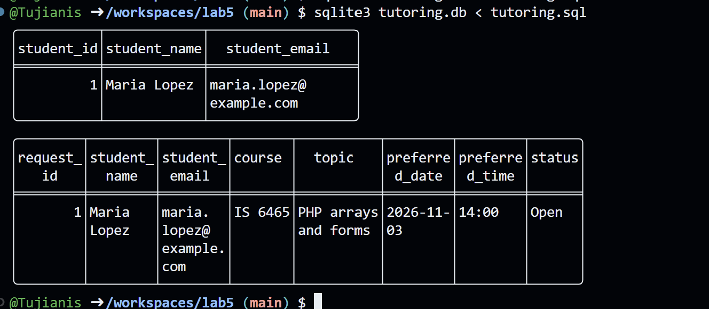
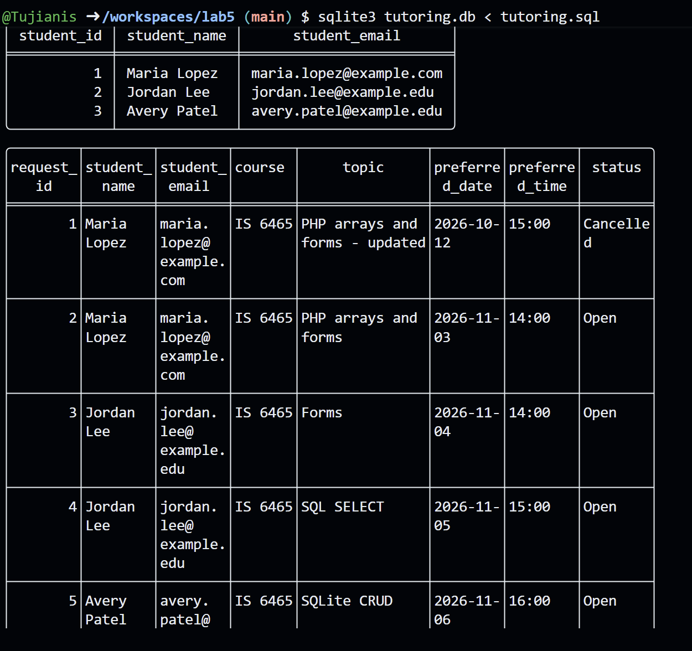
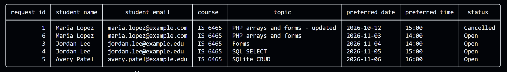
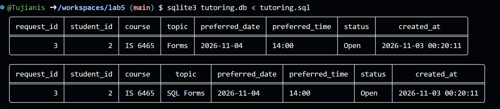
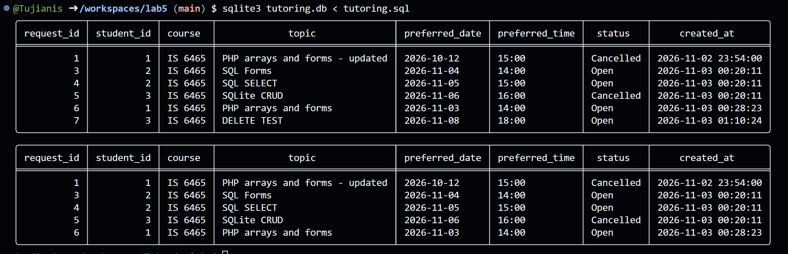

https://glowing-train-95qp4p46x55cp4r7.github.dev/
https://github.com/Tujianis/lab5

Part 1: 1) 

2) The 'student_id' column is PK in the student table. The 'request_id' column is the PK in the tutoring_requests table.

3) 'student_id' in the tutoring_requests is the FK, as it references the PK on the student table.

4) student_email is unique because you do not want multiple accounts with the same email. If that were to happen, you could send a message to the wrong account. Only 1 email may be associated per account, as per the business rules.

Part 2) 
1)   INSERT OR ignore INTO tutoring_requests
  (student_id, course, topic, preferred_date, preferred_time)
VALUES
  (2, 'IS 6465', 'Forms', '2026-11-04', '14:00');

  INSERT OR ignore INTO tutoring_requests
  (student_id, course, topic, preferred_date, preferred_time)
VALUES
  (2, 'IS 6465', 'SQL SELECT', '2026-11-05', '15:00');

  INSERT OR ignore INTO tutoring_requests
  (student_id, course, topic, preferred_date, preferred_time)
VALUES
  (3, 'IS 6465', 'SQLite CRUD', '2026-11-06', '16:00');

2) 
3) Jordan has two request rows because he has two different tutoring sessions at two different times. He only has 1 student account because a student may only have 1 account, but may have many tutoring sessions, and a 1 to M relationship exists between Student and Tutoring-Requests.

Part 3: 

select r.request_id, s.student_name, s.student_email, r.course, r.topic, r.preferred_date, r.preferred_time, r.status
from tutoring_requests r inner join students s on r.student_id = s.student_id
order by preferred_date;

1) The JOIN uses the student_id from the student table and the same column name in the tutoring_request table, and connects those tables together.
2) JOIN combines two tables together, WHERE filters what data is returned in the query by the conditions it has.
3) Application should retrieve by request_id because that will give you one and only one record, since request_id is a PK and therefore unique. If you tried to get one by topic, you'd get every record in the table with that topic.

Part 4: 
2) update tutoring_requests
    set topic = 'SQL Forms'
    where request_id = 3;

3) update tutoring_requests 
    set status = 'Cancelled'
    where request_id = 5;

4) A WHERE clause is essential in an UPDATE because if you do not have the WHERE, it will update every row in the table with the given updates.
5) It uses a cancelled request in order to keep track of the request history. If you delete it, you no longer see the record.

Part 5)

1)   INSERT OR ignore INTO tutoring_requests
  (student_id, course, topic, preferred_date, preferred_time)
VALUES
  (3, 'IS 6465', 'DELETE TEST', '2026-11-08', '18:00');

2)   delete from tutoring_requests where topic = 'DELETE TEST';

3) 

4) WHERE is necessary because without it, it will delete every record from a given table.

Part 6:    
Create: INSERT		INSERT OR ignore INTO tutoring_requests (student_id, course, topic, preferred_date, preferred_time) VALUES
  (3, 'IS 6465', 'DELETE TEST', '2026-11-08', '18:00');
Read:   SELECT      select * from tutoring_requests;
Update: UPDATE		update tutoring_requests set status = 'Cancelled' where request_id = 5;
Delete: DELETE		delete from tutoring_requests where request_id = 5;

1) It preserves the connection between the two tables by using the students table PK as a FK on the tutoring_requests table;

2) UNIQUE constraint prevents the same email from being used on more than 1 account.

3) UPDATE/DELETE without a where will change every row on the table, meaning either every entry gets changed or deleted.

4) They should send them as Parameters to prevent SQL injection and to make sure the data is correct going in so there is no messy data in the DB.